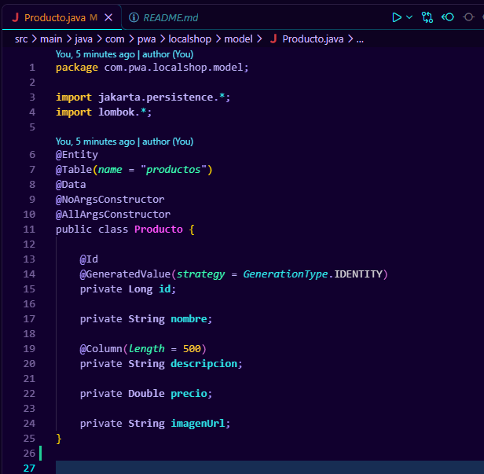
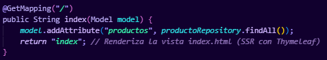
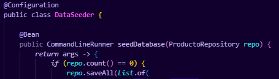
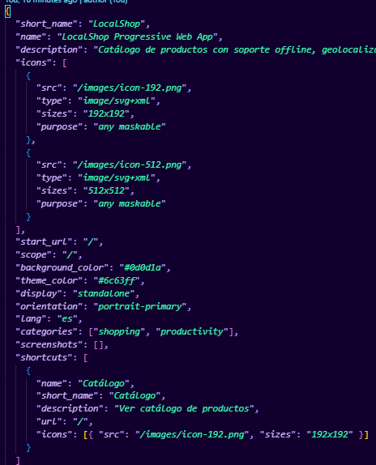

# LocalShop PWA

> **Aplicación Web Progresiva** desarrollada con Java Spring Boot 3, Thymeleaf SSR, Spring Data JPA + H2 y Service Worker para soporte offline.

---

## Autores del Equipo

| # | Nombre |
|---|--------|
| 1 | Austin Gabriel Blanco Aguirre |
| 2 | Arturo Valladares Ruiz |
| 3 | Hiram Alejandro Quintana Soto |
| 4 | Josue Galván Arana |
| 5 | Saúl Eduardo Estrada Martínez |
| 6 | Erick Fernando Alarcón Durán |

---

## Objetivo de la Práctica

Desarrollar e integrar una **Aplicación Web Progresiva (PWA)** utilizando:

- **Java + Spring Boot** con plantillas **Thymeleaf** para el Renderizado del Lado del Servidor (SSR)
- **Persistencia** de datos con Spring Data JPA y base de datos relacional (H2)
- **Arquitectura App Shell** con caché mediante Service Worker
- **Soporte offline** completo mediante estrategia Network-First
- **API nativa del dispositivo**: Geolocalización

---

## Ejecución Local

### Requisitos Previos

| Herramienta | Versión mínima |
|-------------|---------------|
| JDK         | Java 17+      |
| Maven       | 3.6+          |
| Google Chrome | Cualquiera (para Lighthouse) |

### Pasos para ejecutar

**1. Clonar el repositorio**
```bash
git clone <URL_DEL_REPOSITORIO>
cd localshop-pwa
```

**2. Ejecutar con Maven**
```bash
mvn spring-boot:run
```

**3. Abrir en el navegador**
```
http://localhost:8080
```

> La base de datos H2 se crea automáticamente en memoria y se puebla con **6 productos de ejemplo** al iniciar.

**4. Consola H2 (opcional)**
```
http://localhost:8080/h2-console
```
- JDBC URL: `jdbc:h2:mem:localshopdb`
- Usuario: `sa`
- Contraseña: *(vacía)*

---

## Estructura del Proyecto

```
localshop-pwa/
├── src/
│   ├── main/
│   │   ├── java/com/pwa/localshop/
│   │   │   ├── LocalShopApplication.java     # Punto de entrada Spring Boot
│   │   │   ├── config/
│   │   │   │   └── DataSeeder.java           # Datos de ejemplo en BD
│   │   │   ├── controller/
│   │   │   │   └── ProductoController.java   # Controlador MVC (SSR)
│   │   │   ├── model/
│   │   │   │   └── Producto.java             # Entidad JPA
│   │   │   └── repository/
│   │   │       └── ProductoRepository.java   # Repositorio Spring Data JPA
│   │   └── resources/
│   │       ├── templates/
│   │       │   └── index.html                # Vista Thymeleaf (SSR)
│   │       ├── static/
│   │       │   ├── manifest.json             # Web App Manifest (PWA)
│   │       │   ├── sw.js                     # Service Worker
│   │       │   ├── css/app.css               # Estilos personalizados
│   │       │   ├── js/app.js                 # Lógica frontend (geo, SW, install)
│   │       │   └── images/
│   │       │       ├── icon-192.png          # Ícono PWA 192x192
│   │       │       └── icon-512.png          # Ícono PWA 512x512
│   │       └── application.properties        # Configuración H2, JPA, Thymeleaf
│   └── test/
│       └── java/com/pwa/localshop/
│           └── ProductoRepositoryTest.java   # Test unitario de repositorio
└── pom.xml                                   # Dependencias Maven
```

---

## Fases de Desarrollo

### Etapa 1 — Configuración de Base de Datos y Modelo (Back-End SSR)

#### Entidad `Producto.java`

La entidad persistente está mapeada con **JPA** para gestionar el catálogo de productos.

```java
@Entity
@Table(name = "productos")
@Data @NoArgsConstructor @AllArgsConstructor
public class Producto {
    @Id @GeneratedValue(strategy = GenerationType.IDENTITY)
    private Long id;
    private String nombre;
    @Column(length = 500)
    private String descripcion;
    private Double precio;
    private String imagenUrl;
}
```



**Diagrama del flujo SSR:**

```
Navegador  ──GET /──►  ProductoController
                              │
                    productoRepository.findAll()
                              │
                         H2 Database
                              │
                    Lista<Producto> ◄───
                              │
               model.addAttribute("productos", ...)
                              │
                  Thymeleaf procesa index.html
                              │
                  HTML completo ──► Navegador
```

#### `ProductoRepository.java`

Interfaz que extiende `JpaRepository`, proporcionando automáticamente operaciones CRUD sin implementación manual:

```java
public interface ProductoRepository extends JpaRepository<Producto, Long> {}
```


#### `ProductoController.java`

Controlador MVC que recibe la petición GET en `/`, consulta la base de datos a través del repositorio e inyecta los datos en la vista Thymeleaf:

```java
@GetMapping("/")
public String index(Model model) {
    model.addAttribute("productos", productoRepository.findAll());
    return "index"; // SSR con Thymeleaf
}
```



#### `DataSeeder.java`

Ejecuta al iniciar la app y puebla la BD con 6 productos de ejemplo si está vacía:

```java
@Bean
public CommandLineRunner seedDatabase(ProductoRepository repo) {
    return args -> {
        if (repo.count() == 0) {
            repo.saveAll(List.of(...)); // 6 productos pre-cargados
        }
    };
}
```



---

### Etapa 2 — Componentes PWA: Manifiesto y App Shell SSR

#### Manifiesto Web (`manifest.json`)

Define los metadatos de instalación de la PWA:

```json
{
  "short_name": "LocalShop",
  "name": "LocalShop Progressive Web App",
  "start_url": "/",
  "background_color": "#0d0d1a",
  "theme_color": "#6c63ff",
  "display": "standalone"
}
```



| Propiedad | Valor | Descripción |
|-----------|-------|-------------|
| `display` | `standalone` | La app se abre sin barra de navegador |
| `start_url` | `/` | URL de inicio al abrir la PWA instalada |
| `theme_color` | `#6c63ff` | Color de la barra de estado del SO |
| `background_color` | `#0d0d1a` | Color del splash screen al abrir |

#### Vista Thymeleaf — App Shell (`index.html`)

La plantilla HTML integra el **App Shell** (navbar fijo, footer) con el **contenido dinámico** inyectado por el servidor.

Fragmento de renderizado SSR con Thymeleaf:
```html
<!-- th:each itera sobre la lista inyectada por el Controller -->
<div class="col-md-4 mb-3" th:each="producto : ${productos}">
    <h5 th:text="${producto.nombre}">Nombre</h5>
    <p  th:text="${producto.descripcion}">Descripción</p>
    <p  th:text="${'$' + producto.precio}">$0.00</p>
</div>
```

La **Geolocalización** se accede mediante la API nativa del navegador:
```javascript
navigator.geolocation.getCurrentPosition(
    pos => { /* mostrar latitud y longitud */ },
    err => { /* manejar error de permisos */ },
    { enableHighAccuracy: true, timeout: 10000 }
);
```

---

### Etapa 3 — Service Worker y Soporte Offline (`sw.js`)

#### Estrategia: Network-First con fallback a caché

```
Petición ──► Red disponible?
              ├── SÍ ──► Respuesta fresca + guarda en caché ──► Cliente
              └── NO ──► Busca en caché
                          ├── Encontrado ──► Respuesta cacheada ──► Cliente
                          └── No encontrado ──► Página offline amigable
```

#### Fases del ciclo de vida del Service Worker

| Evento | Acción |
|--------|--------|
| `install` | Pre-cachea el App Shell (HTML, CSS, JS, imágenes) |
| `activate` | Elimina cachés anteriores y toma control de clientes |
| `fetch` | Intercepta peticiones GET: Network-First con caché |

#### Recursos pre-cacheados en el App Shell:

```javascript
const APP_SHELL_ASSETS = [
    '/',
    '/manifest.json',
    '/css/app.css',
    '/js/app.js',
    'https://cdn.jsdelivr.net/.../bootstrap.min.css',
    '/images/icon-192.png',
    '/images/icon-512.png'
];
```

---

## Configuración (`application.properties`)

```properties
# Base de datos H2 (en memoria)
spring.datasource.url=jdbc:h2:mem:localshopdb
spring.jpa.hibernate.ddl-auto=create-drop
spring.jpa.show-sql=true

# Consola H2 para inspección en desarrollo
spring.h2.console.enabled=true
spring.h2.console.path=/h2-console

# Thymeleaf SSR
spring.thymeleaf.cache=false
spring.thymeleaf.encoding=UTF-8
```

---

## Pruebas

### Ejecutar tests unitarios
```bash
mvn test
```

### Auditoría Lighthouse (Chrome DevTools)

1. Abrir `http://localhost:8080` en Google Chrome
2. Presionar `F12` → pestaña **Lighthouse**
3. Seleccionar categoría **Progressive Web App**
4. Click en **Analyze page load**

**Criterios evaluados por Lighthouse:**
- Tiene manifest.json válido
- Service Worker registrado
- Funciona offline
- Íconos PWA correctos
- Metadatos `theme-color` y `viewport`
- Instalable como app

### Probar modo offline manualmente

1. Abrir Chrome DevTools → pestaña **Application**
2. Sección **Service Workers** → verificar que aparece registrado
3. Sección **Cache Storage** → ver recursos cacheados
4. En la pestaña **Network**, activar modo **Offline**
5. Recargar la página → debe servirse desde caché

---

## Stack Tecnológico

| Tecnología | Versión | Rol |
|-----------|---------|-----|
| Java      | 17+     | Lenguaje principal |
| Spring Boot | 3.2.5 | Framework backend |
| Spring Web MVC | 3.2.5 | Controladores HTTP |
| Spring Data JPA | 3.2.5 | ORM y repositorios |
| Thymeleaf | 3.x | Motor de plantillas SSR |
| H2 Database | 2.x | BD en memoria (desarrollo) |
| Lombok | 1.18.x | Reducción de boilerplate |
| Bootstrap | 5.3.0 | Framework CSS |
| Service Worker | Web API | Caché offline |
| Web Manifest | PWA API | Instalación nativa |
| Geolocation API | Web API | API nativa del dispositivo |

---

## Dependencias Maven (`pom.xml`)

```xml
<dependencies>
    <dependency>spring-boot-starter-web</dependency>        <!-- Spring MVC -->
    <dependency>spring-boot-starter-thymeleaf</dependency>  <!-- SSR -->
    <dependency>spring-boot-starter-data-jpa</dependency>   <!-- ORM + JPA -->
    <dependency>h2</dependency>                              <!-- BD en memoria -->
    <dependency>lombok</dependency>                          <!-- Boilerplate -->
    <dependency>spring-boot-starter-test</dependency>        <!-- Tests -->
</dependencies>
```

---

## Notas Adicionales

- **H2 es en memoria**: los datos se pierden al detener la aplicación (comportamiento esperado para desarrollo). Para producción, cambiar a PostgreSQL/MySQL en `application.properties`.
- El **Service Worker** solo funciona en `localhost` o con **HTTPS** en producción.
- El botón **"Instalar App"** aparece automáticamente en Chrome cuando se cumplen los criterios PWA.
- La consola H2 (`/h2-console`) está habilitada **solo para desarrollo**; debe deshabilitarse en producción.
